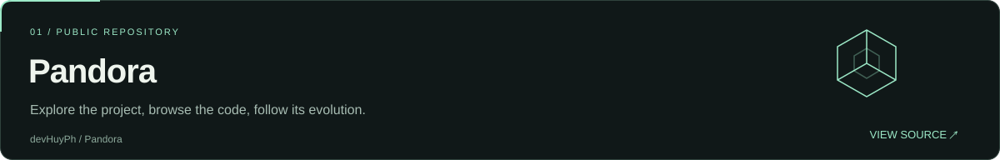
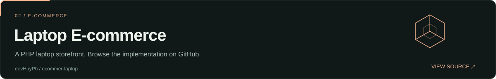
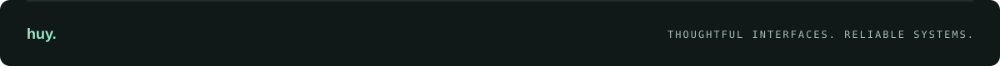

  
    
  <a href="#selected-work">Selected work</a> &nbsp; / &nbsp;
  <a href="#engineering-toolkit">Toolkit</a> &nbsp; / &nbsp;
  <a href="https://github.com/devHuyPh?tab=repositories">All repositories ↗</a>

 

## A practical approach to building software.

I'm **Huy**, a full-stack engineer working across web products, business applications, and backend systems. I enjoy connecting the details people see with the systems that make them work.

<table>
  <tr>
    <td width="33%" valign="top">
      01 / PRODUCT
      <h3>Make it useful.</h3>
      
Web platforms, e-commerce, and operational tools built around real workflows.

    </td>
    <td width="33%" valign="top">
      02 / ENGINEERING
      <h3>Make it reliable.</h3>
      
Clear APIs, considered data models, and maintainable application logic.

    </td>
    <td width="33%" valign="top">
      03 / DELIVERY
      <h3>Make it work.</h3>
      
Attention to interfaces, performance, deployment, and everyday operation.

    </td>
  </tr>
</table>

 

## Selected work

A few places to explore my public code.

 

## Engineering toolkit

| Layer | Technologies |
| :--- | :--- |
| **Backend & data** | PHP · Laravel · MySQL · Redis |
| **Frontend & UI** | JavaScript · TypeScript · Vue · React · HTML · CSS · Tailwind CSS |
| **Infrastructure** | Linux · Docker · Nginx |
| **Daily tools** | Git · GitHub · VS Code |

 

## Behind the commits

<picture>
  <source media="(prefers-color-scheme: dark)" srcset="https://raw.githubusercontent.com/devHuyPh/devHuyPh/output/github-contribution-grid-snake-dark.svg" />
  <source media="(prefers-color-scheme: light)" srcset="https://raw.githubusercontent.com/devHuyPh/devHuyPh/output/github-contribution-grid-snake.svg" />
  
</picture>

A little motion from the work along the way.

 

  <h2>Good software starts with a clear idea.</h2>
  
Explore the code, follow what I'm building, or start a conversation.

  <a href="https://github.com/devHuyPh?tab=repositories"><b>Explore my repositories ↗</b></a>
  &nbsp; · &nbsp;
  <a href="https://github.com/devHuyPh"><b>Find me on GitHub ↗</b></a>
    
  

