<div align="center">
  

  <br />

  

  <p>
    <a href="https://github.com/devHuyPh?tab=repositories"></a>
    <a href="https://github.com/devHuyPh"></a>
  </p>
</div>

---

### `01 / ABOUT`

```yaml
name: Huy Phung
role: Full-Stack Developer
focus:
  - Business web platforms & e-commerce
  - APIs, backend systems & database performance
  - Workflow automation & production operations
approach: "Design. Build. Optimize. Scale."
```

I build practical, maintainable software — from web interfaces and backend APIs to business workflows and production deployment. I care about clear architecture, performance, and solutions that solve real operational problems.

### `02 / TECH STACK`

**Backend & databases**

<p></p>

**Frontend**

<p></p>

**Infrastructure & tools**

<p></p>

> Currently focused on scalable web applications, database optimization, and intelligent automation.

### `03 / SELECTED WORK`

<div align="center">
  <a href="https://github.com/devHuyPh/Pandora"></a>
  <a href="https://github.com/devHuyPh/ecommer-laptop"></a>
</div>

**Pandora** — [View code →](https://github.com/devHuyPh/Pandora)  
**Laptop E-commerce** — [View code →](https://github.com/devHuyPh/ecommer-laptop)

*These are public repositories. More production work may be private or covered by client confidentiality.*

### `04 / GITHUB ANALYTICS`

<div align="center">
  
  
  <br />
  
  <br />
  
</div>

### `05 / CONTRIBUTION ANIMATION`

<div align="center">
  <picture>
    <source media="(prefers-color-scheme: dark)" srcset="https://raw.githubusercontent.com/devHuyPh/devHuyPh/output/github-contribution-grid-snake-dark.svg" />
    <source media="(prefers-color-scheme: light)" srcset="https://raw.githubusercontent.com/devHuyPh/devHuyPh/output/github-contribution-grid-snake.svg" />
    
  </picture>
</div>

### `06 / CONNECT`

<div align="center">
  <a href="https://github.com/devHuyPh"></a>
  <p><b>Open to collaborations on thoughtful web platforms and automation.</b></p>
  <sub>DESIGN &nbsp;·&nbsp; BUILD &nbsp;·&nbsp; OPTIMIZE &nbsp;·&nbsp; SCALE</sub>
</div>
