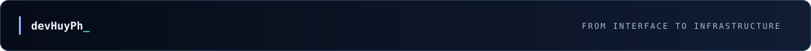

  
    
  
  

    
  

  

    <a href="#01--engineering-profile">About</a> &nbsp;·&nbsp;
    <a href="#02--toolkit">Toolkit</a> &nbsp;·&nbsp;
    <a href="#05--lets-connect">Connect</a>
  

---

### `01 // ENGINEERING PROFILE`

**Hi, I'm Huy.** I build practical web products, business applications, and backend systems, connecting thoughtful interfaces with reliable infrastructure.

<table><tr><td width="50%" valign="top">

**WHAT I BUILD**

- Business platforms & e-commerce
- APIs, workflows & automation
- Admin dashboards & operational tools

</td><td width="50%" valign="top">

**HOW I WORK**

- Performance-minded architecture
- Database & production optimization
- Clean interfaces and reliable delivery

</td></tr></table>

 

### `02 // TOOLKIT`

<table>
  <tr>
    <td valign="middle"><b>Backend &amp; data</b> APPLICATION LOGIC / STORAGE</td>
    <td></td>
  </tr>
  <tr>
    <td valign="middle"><b>Frontend &amp; UI</b> INTERFACES / EXPERIENCE</td>
    <td></td>
  </tr>
  <tr>
    <td valign="middle"><b>Infrastructure &amp; tools</b> DEPLOYMENT / WORKFLOW</td>
    <td></td>
  </tr>
</table>

 

### `03 // GITHUB SIGNAL`

  
  
   
  

Language distribution reflects accessible repositories, not total professional experience.

 

### `04 // CONTRIBUTION ACTIVITY`

  <picture>
    <source media="(prefers-color-scheme: dark)" srcset="https://raw.githubusercontent.com/devHuyPh/devHuyPh/output/contribution-neon-dark.svg" />
    <source media="(prefers-color-scheme: light)" srcset="https://raw.githubusercontent.com/devHuyPh/devHuyPh/output/contribution-neon-light.svg" />
    
  </picture>

 

### `05 // LET'S CONNECT`

  
  
<b>Interested in building thoughtful software together?</b>

  DESIGN &nbsp;·&nbsp; BUILD &nbsp;·&nbsp; OPTIMIZE &nbsp;·&nbsp; SCALE
    
  

